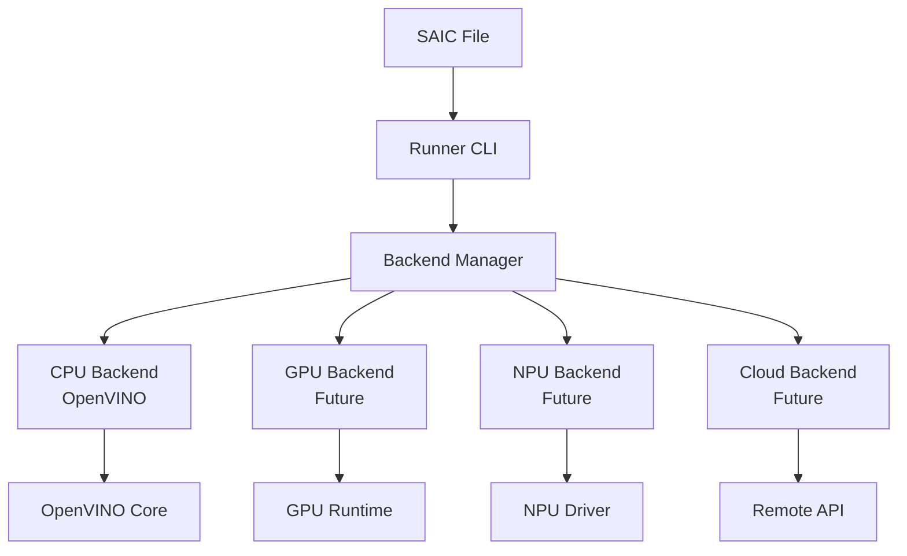

# Backend Architecture

**SAIC Execution Backend System Design**

The SAIC runner implements a flexible, trait-based backend architecture that allows multiple AI inference engines to execute models from SAIC containers.

## 🏗️ Architecture Overview



## 🔌 Backend Trait Interface

### Core Trait Definition

```rust
/// Trait defining the interface for AI model execution backends
pub trait Backend {
    /// Execute a model using the backend's inference engine
    fn execute(&mut self, model_payload: &[u8], model_name: &str) -> Result<(), BackendError>;
    
    /// Get the backend name for identification and logging
    fn name(&self) -> &str;
    
    /// Check if the backend is available on the current system
    fn is_available(&self) -> bool;
}
```

### Error Handling

```rust
/// Backend-specific error types for model execution
#[derive(Debug)]
pub enum BackendError {
    /// Backend initialization failed
    OpenVinoInitFailed(String),
    /// Model loading or parsing failed
    ModelLoadFailed(String),
    /// Model compilation failed
    CompilationFailed(String),
    /// Device not available or incompatible
    DeviceNotAvailable(String),
    /// Invalid model format for backend
    InvalidModelFormat(String),
    /// Generic backend execution error
    ExecutionError(String),
}
```

## 💻 CPU Backend (OpenVINO)

### Implementation Details

The CPU backend uses Intel OpenVINO for optimized CPU inference:

```rust
pub struct CpuBackend {
    /// OpenVINO Core instance for model operations
    core: Option<Core>,
}
```

### Execution Pipeline

1. **Lazy Initialization**: OpenVINO Core initialized on first use
2. **Model Loading**: Parse model from raw bytes
3. **Compilation**: Compile for CPU target device
4. **Validation**: Verify successful compilation
5. **Cleanup**: Automatic resource management

### Performance Characteristics

| Metric | Performance |
|--------|-------------|
| **Initialization** | ~50ms (lazy, cached) |
| **Model Loading** | ~10-100ms (depends on size) |
| **Compilation** | ~100ms-1s (cached after first) |
| **Memory Usage** | Model size + 50MB overhead |
| **Supported Formats** | OpenVINO IR, ONNX |

## 🔮 Future Backends

### GPU Backend (Planned v0.2)

```rust
pub struct GpuBackend {
    device_id: DeviceId,
    context: GpuContext,
    memory_pool: GpuMemoryPool,
}

impl Backend for GpuBackend {
    fn execute(&mut self, model_payload: &[u8], model_name: &str) -> Result<(), BackendError> {
        // GPU-optimized execution pipeline
        todo!("Implement GPU execution")
    }
    
    fn name(&self) -> &str {
        "GPU (OpenVINO)"
    }
    
    fn is_available(&self) -> bool {
        // Check GPU availability and capabilities
        todo!("GPU device detection")
    }
}
```

### NPU Backend (Planned v0.3)

```rust
pub struct NpuBackend {
    device_handle: NpuHandle,
    firmware_version: Version,
}
```

**Target NPU Devices**:
- Intel Movidius
- Intel Loihi
- ARM Ethos-N
- Qualcomm AI Engine

### Cloud Backend (Planned v0.4)

```rust
pub struct CloudBackend {
    endpoint: Url,
    api_key: ApiKey,
    region: CloudRegion,
}
```

**Supported Providers**:
- AWS Sagemaker
- Azure ML
- Google AI Platform
- Custom endpoints

## 🔄 Backend Selection

### Automatic Backend Selection

```rust
pub fn select_optimal_backend(
    model_info: &ModelInfo,
    system_info: &SystemInfo,
    preferences: &UserPreferences,
) -> Box<dyn Backend> {
    // Selection algorithm based on:
    // 1. Model requirements (compute, memory)
    // 2. Available hardware
    // 3. Performance characteristics
    // 4. User preferences
}
```

### Selection Criteria

1. **Hardware Availability**
   - CPU: Always available
   - GPU: Check OpenCL/CUDA support
   - NPU: Device-specific detection
   - Cloud: Network connectivity

2. **Model Compatibility**
   - Format support (IR, ONNX, TensorFlow, PyTorch)
   - Precision requirements (FP32, FP16, INT8)
   - Operator coverage

3. **Performance Requirements**
   - Latency vs throughput
   - Memory constraints
   - Power consumption

4. **User Preferences**
   - Explicit backend selection
   - Cost considerations
   - Privacy requirements

## 🛡️ Security Considerations

### Model Isolation

Each backend ensures:

- **Process Isolation**: Model execution in sandboxed environment
- **Memory Protection**: Secure memory management
- **Resource Limits**: CPU, memory, and time constraints
- **Error Containment**: Failures don't affect other models

### Trust Boundaries

```rust
pub trait SecureBackend: Backend {
    /// Verify model signature before execution
    fn verify_model(&self, model: &[u8], signature: &Signature) -> Result<bool>;
    
    /// Execute with security constraints
    fn secure_execute(&mut self, model: &[u8], constraints: &SecurityPolicy) -> Result<()>;
}
```

### Audit Trail

All backend operations are logged:

```rust
// Example audit log entry
{
    "timestamp": "2024-01-15T10:30:00Z",
    "backend": "CPU (OpenVINO)",
    "operation": "model_execution",
    "model_id": "sha256:abc123...",
    "duration_ms": 150,
    "memory_peak_mb": 245,
    "status": "success"
}
```

## 🔧 Backend Development

### Creating a New Backend

1. **Implement the Backend Trait**
```rust
pub struct MyBackend {
    // Backend-specific state
}

impl Backend for MyBackend {
    fn execute(&mut self, model_payload: &[u8], model_name: &str) -> Result<(), BackendError> {
        // Implementation
    }
    
    fn name(&self) -> &str {
        "My Custom Backend"
    }
    
    fn is_available(&self) -> bool {
        // Availability check
        true
    }
}
```

2. **Add Error Variants**
```rust
pub enum BackendError {
    // Existing variants...
    MyBackendError(String),
}
```

3. **Register Backend**
```rust
pub fn create_backend(backend_type: BackendType) -> Box<dyn Backend> {
    match backend_type {
        BackendType::Cpu => Box::new(CpuBackend::new()),
        BackendType::MyCustom => Box::new(MyBackend::new()),
    }
}
```

4. **Add Tests**
```rust
#[cfg(test)]
mod tests {
    use super::*;

    #[test]
    fn test_my_backend_basic_execution() {
        let mut backend = MyBackend::new();
        let result = backend.execute(b"test_model", "test");
        assert!(result.is_ok());
    }
}
```

### Backend Testing Guidelines

1. **Unit Tests**: Test individual backend methods
2. **Integration Tests**: Test with real models
3. **Performance Tests**: Benchmark execution times
4. **Error Tests**: Verify error handling
5. **Resource Tests**: Check memory/CPU usage

### Development Environment Setup

```bash
# Install required dependencies
sudo apt-get install intel-openvino-dev

# Set environment variables
export INTEL_OPENVINO_DIR=/opt/intel/openvino
export LD_LIBRARY_PATH=$INTEL_OPENVINO_DIR/runtime/lib

# Build with all backends
cargo build --features all-backends
```

## 📊 Backend Comparison

### Performance Comparison

| Backend | Latency | Throughput | Memory | Power | Formats |
|---------|---------|------------|--------|-------|---------|
| **CPU** | Medium | Medium | High | Low | IR, ONNX |
| **GPU** | Low | High | Medium | High | IR, ONNX |
| **NPU** | Low | High | Low | Very Low | IR |
| **Cloud** | High | Very High | Unlimited | N/A | All |

### Use Case Recommendations

- **CPU**: Development, testing, general-purpose inference
- **GPU**: High-throughput batch processing, computer vision
- **NPU**: Edge devices, real-time inference, power-constrained
- **Cloud**: Large-scale deployment, variable workloads

## 🔍 Troubleshooting

### Common Issues

1. **Backend Not Available**
   - Check system requirements
   - Verify driver installation
   - Review dependency versions

2. **Model Loading Failures**
   - Validate model format
   - Check model compatibility
   - Verify model integrity

3. **Compilation Errors**
   - Update backend runtime
   - Check model operators
   - Verify device capabilities

### Debug Information

Enable detailed logging:

```bash
RUST_LOG=debug ./runner execute model.saic
```

Generate backend report:

```bash
./runner backends --report
```

---

**Architecture Version**: v0.1.0  
**Last Updated**: Initial OpenVINO implementation  
**Next Review**: After GPU backend addition 